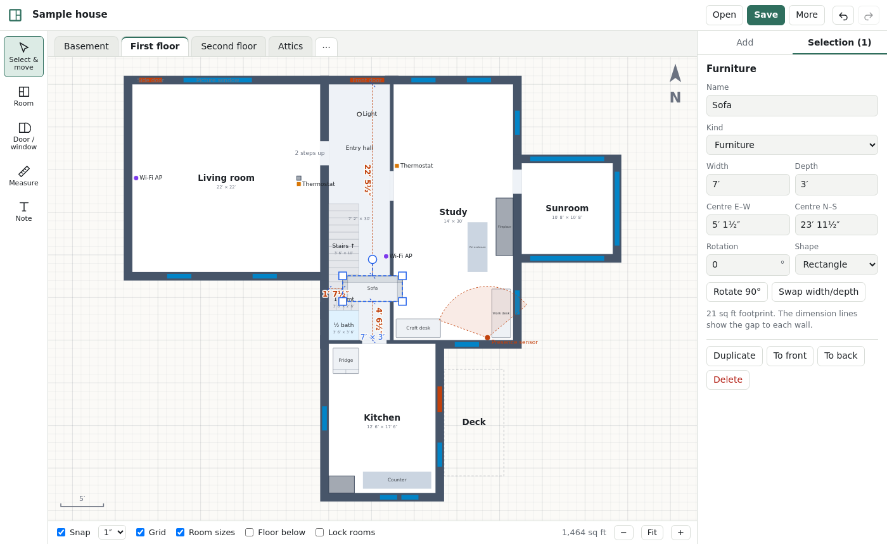

# Home Designer

A floor-plan editor that runs entirely in the browser. Draw rooms, doors and windows to real
measurements, drag furniture around, measure anything, and save the result as an SVG you can open
again later, or view in any browser or vector editor. Nothing is uploaded anywhere.



## What it does

- **Rooms:** drag out a rectangle, or click corner by corner for any shape. Type exact sizes
  (`12' 6"`, `6 1/2"`, `3.5`, `1.2m`) or drag a wall or corner. Walls are drawn around the rooms
  automatically. Turn on **Room sizes** to label every room with its dimensions.
- **Doors and windows:** draw along a wall and they snap onto it. Drag them along the wall, or
  type a width and position.
- **Furniture:** about forty common pieces at standard sizes (beds, sofas, desks, kitchen and bath
  fixtures, appliances). Click or drag one in, then move, resize or rotate it. While a piece is
  selected, dimension lines show the gap to each wall, and its sides stick to walls as you drag.
- **Measurements:** the **Measure** tool leaves dimension lines that snap to corners. Selecting a
  room shows the length of every wall.
- **Floors:** any number of levels, with a faded **Floor below** overlay for lining up stairs
  and windows between floors.
- **Devices:** lights, Wi-Fi APs, thermostats, and presence sensors with an adjustable field of
  view, for planning smart-home coverage.
- **Files:**
  - **Save** writes an SVG with the whole project embedded, so it reopens exactly as it was
    left. In Chrome and Edge it saves straight back to the file you opened.
  - **Open** takes those SVGs, project `.json` files, or plain SVG floor plans; imported shapes
    become rooms. Dropping a file on the window opens it too.
  - Your work is kept as a draft in this browser between visits.

Shortcuts: <kbd>V</kbd> select, <kbd>B</kbd> room, <kbd>W</kbd> door/window, <kbd>M</kbd> measure,
<kbd>T</kbd> note, <kbd>R</kbd> rotate 90°, <kbd>F</kbd> fit, <kbd>G</kbd> grid, arrows nudge
(<kbd>Shift</kbd> for a foot), <kbd>Ctrl</kbd>+<kbd>Z</kbd>/<kbd>Y</kbd>, <kbd>Ctrl</kbd>+<kbd>D</kbd>
duplicate, <kbd>Ctrl</kbd>+<kbd>C</kbd>/<kbd>V</kbd>, <kbd>Ctrl</kbd>+<kbd>S</kbd> save.
<kbd>Shift</kbd> keeps lines straight and adds to the selection, and <kbd>Alt</kbd> turns off snapping.

## Develop

```bash
npm install
npm run dev        # http://localhost:5173
npm test           # unit tests (units, geometry, SVG save/load/import)
npm run build      # static site in dist/
```

The build is a plain static site with relative paths, so `dist/` can be served from any folder or
static host.

## How it's put together

| File | What it does |
|---|---|
| `src/model.ts` | The document: levels of rooms, items, marks (doors/windows), points, dimensions and notes, all in feet |
| `src/render.tsx` | Draws a level. Shared by the editor and SVG export, so a saved file looks like the editor |
| `src/Canvas.tsx` | Pan/zoom, selection, dragging, resizing, rotating, drawing and live measurements |
| `src/Inspector.tsx` | The selection panel, with feet-and-inches fields |
| `src/svgio.ts` | Save to SVG (project embedded in `<metadata>`), open SVG/JSON, import plain SVGs |
| `src/units.ts` | Parsing and formatting lengths |
| `src/catalog.ts` | Furniture sizes |
| `src/samples/sample.json` | The sample house it opens with |

Coordinates are in feet with north up and y growing southward. Rooms are stored by their inside
faces, and wall thickness is drawn outward from them.
